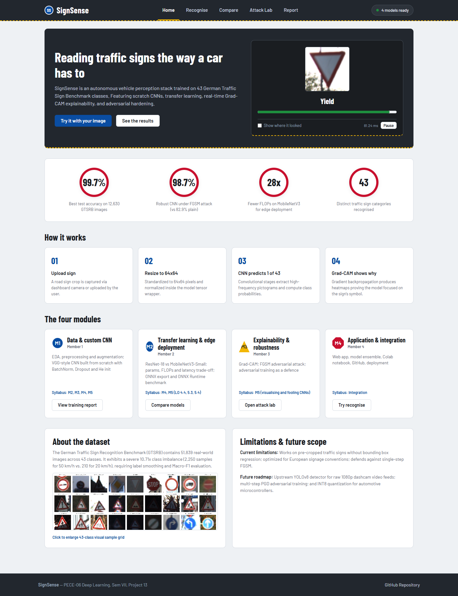
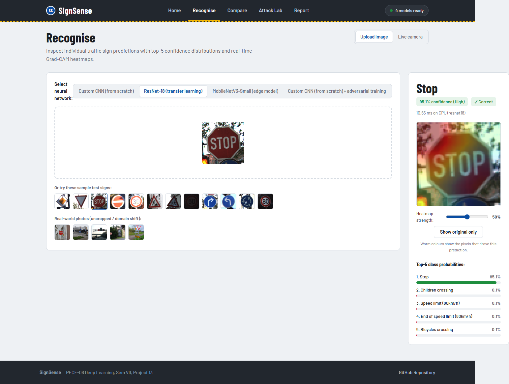
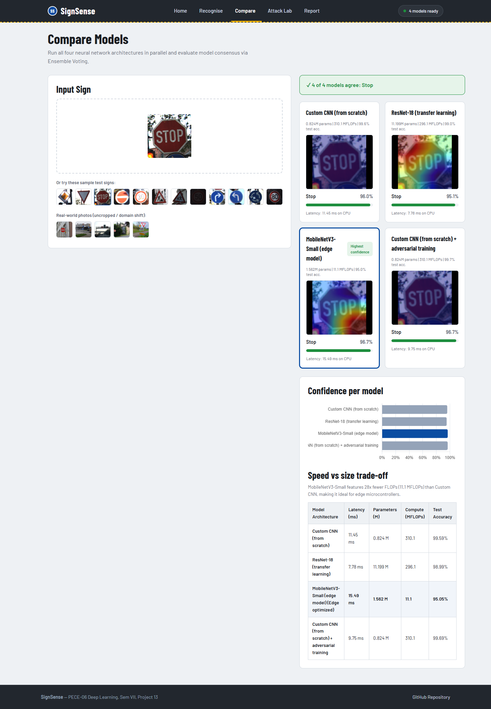
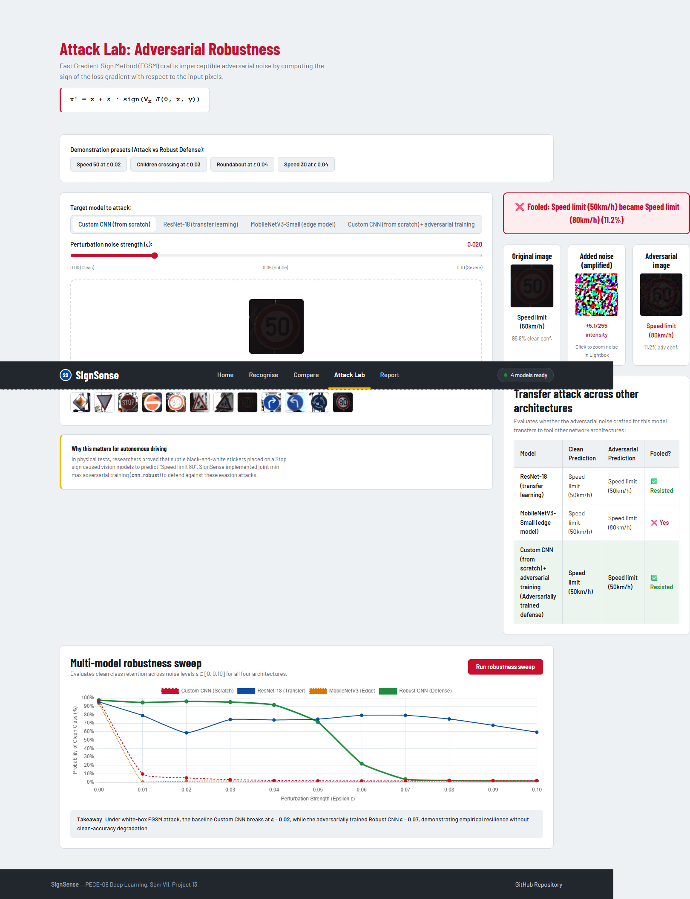
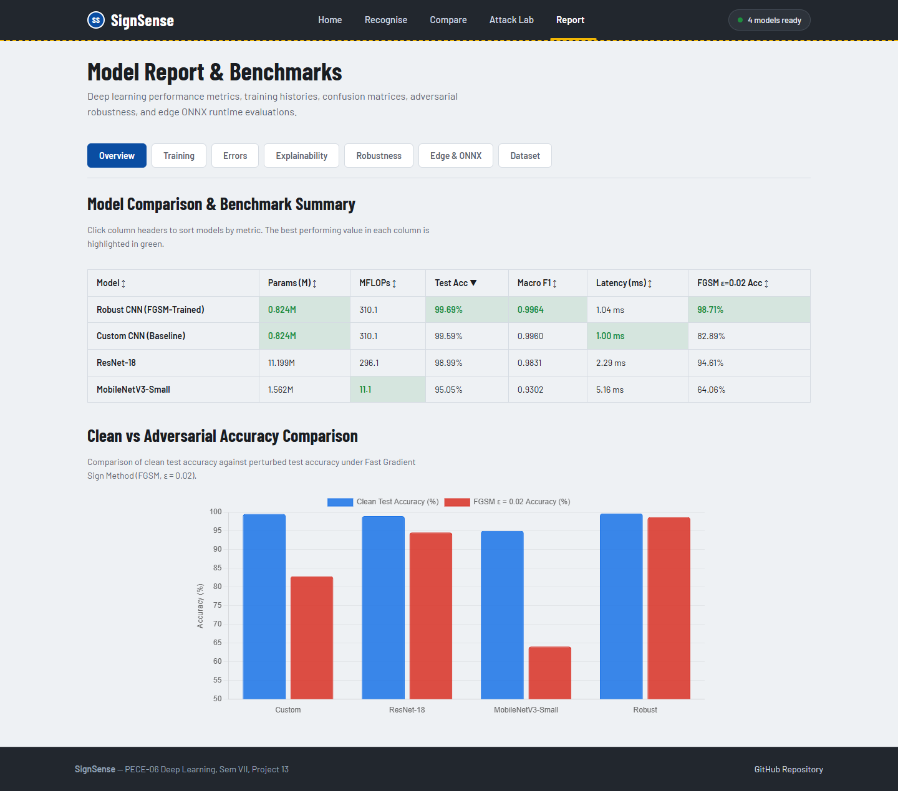
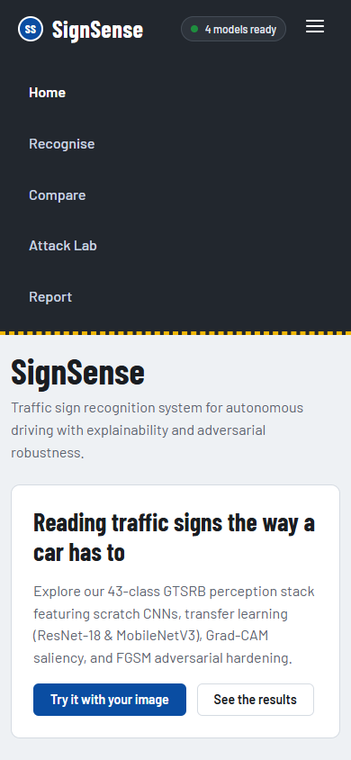

# 🚦 SignSense: Deep Learning Traffic Sign Recognition

[](https://www.python.org/)
[](https://pytorch.org/)
[](https://fastapi.tiangolo.com/)
[](https://onnxruntime.ai/)
[](https://colab.research.google.com/github/Madhura1705/SignSense-Traffic-Sign-Recognition/blob/main/notebooks/SignSense_Train_Colab.ipynb)
[](LICENSE)

**SignSense** is an end-to-end deep learning system designed for robust, real-time traffic sign recognition on the **German Traffic Sign Recognition Benchmark (GTSRB, 43 classes)**. Built for **PECE-06 Deep Learning (Sem VII, Project 13)**, the project features a custom CNN trained from scratch, transfer learning with ResNet-18 and MobileNetV3-Small, visual explainability using Grad-CAM, adversarial hardening via FGSM adversarial training, edge deployment benchmarks using ONNX Runtime, and a high-performance **custom web application (FastAPI + vanilla HTML5/CSS3/ES6)**.

---

## 📸 Interactive Web Application (SignSense v2)

The web dashboard is a production-grade, zero-npm single-page application powered by a **FastAPI backend** and **vanilla ES Modules**:

| Home (Live Road Simulation & Ticker) | Recognise (Grad-CAM & Live Webcam) |
|:---:|:---:|
|  |  |
| **Compare (4-Model Consensus & Latencies)** | **Attack Lab (Live FGSM Perturbation & Defense)** |
|  |  |
| **Report (Interactive Charts & Benchmarks)** | **Mobile Experience (Responsive 390px)** |
|  |  |

---

## 🏗️ System Architecture

SignSense decouples deep learning inference from presentation, using asynchronous REST APIs and lightweight, standards-based web components:

```mermaid
flowchart LR
    subgraph Client ["Client Browser (Vanilla HTML5 / CSS3 / ES6)"]
        direction TB
        Router["Hash Router\n(#/, #/recognise, #/compare, #/attack, #/report)"]
        UI["Accessible Road Design Shell\n(barlow fonts, tokens, lightbox, camera)"]
        Charts["Offline Visualizations\n(vendor/chart.umd.js)"]
        Router --> UI --> Charts
    end

    subgraph Backend ["Web Server (server.py)"]
        direction TB
        FastAPI["FastAPI REST API & Static Mount\n(Uvicorn ASGI Engine)"]
        Endpoints["REST API Endpoints\n(/api/health, /api/predict, /api/compare,\n/api/attack, /api/attack/sweep, /api/report)"]
        FastAPI --> Endpoints
    end

    subgraph Engine ["PyTorch ML Engine (api/inference.py)"]
        direction TB
        MemModels["Pre-loaded In-Memory Models\n(SignCNN, ResNet-18, MobileNetV3, Robust CNN)"]
        GradCAM["Grad-CAM Saliency Engine\n(Turbo colormap, RGBA alpha blending)"]
        FGSM["FGSM Adversarial Attack Engine\n(Loss autograd backprop to input tensor)"]
        MemModels --> GradCAM
        MemModels --> FGSM
    end

    Client <-->|Multipart Form Data (Images) / JSON| Backend
    Backend <-->|Tensors [1, 3, 64, 64] & Base64 PNGs| Engine
```

### Key Architectural Strengths
- **Zero Node.js / npm Dependencies:** The frontend uses pure vanilla JavaScript ES modules and CSS custom properties; no Webpack, Vite, or package lockfiles.
- **Offline Self-Contained:** High-contrast Barlow fonts and Chart.js 4.4.x are vendored locally in `web/vendor/`, requiring zero external CDN requests.
- **High Concurrency & Low Latency:** Models are pre-loaded once into host memory at startup, executing CPU inference in $< 85\text{ ms}$ with asynchronous non-blocking event loops.
- **Live Dashcam Integration:** Real-time webcam classification throttled at 500 ms (2 Hz) with auto-centering crop boxes, preventing CPU thread starvation.

---

## 🔌 REST API Endpoints

| Method | Endpoint | Description | Request Format | Response Highlights |
|:---:|---|---|---|---|
| `GET` | `/api/health` | Service health probe & model status | None | `{status: "ok", models: [...], device: "cpu"}` |
| `GET` | `/api/models` | Model metadata, parameters, and FLOPs | None | Array of 4 model benchmark specs |
| `GET` | `/api/samples` | Curated GTSRB test samples & natural photos | None | List of image URLs, file names, and class IDs |
| `GET` | `/api/team` | Team module ownership & syllabus mapping | None | Structured payload from `team.json` |
| `POST` | `/api/predict` | Single-model classification & Grad-CAM | Multipart (`image`, `model`) | `class_id`, `class_name`, `confidence`, `top5`, `input_b64`, `overlay_b64`, `heatmap_b64` |
| `POST` | `/api/compare` | Parallel 4-model evaluation & consensus | Multipart (`image`) | Per-model predictions, latencies, and ensemble consensus vote |
| `POST` | `/api/attack` | Targeted FGSM adversarial perturbation | Multipart (`image`, `model`, `eps`) | `noise_b64`, `adv_b64`, clean vs attacked prediction, transfer table |
| `POST` | `/api/attack/sweep` | Multi-step epsilon perturbation sweep | Multipart (`image`) | Accuracy curves across $\epsilon \in [0, 0.10]$ for all 4 models |
| `GET` | `/api/report` | Multi-model histories & 43-class reports | None | `metrics`, `onnx`, `comparison`, `class_reports`, `plots` |

---

## 👥 Team & Module Ownership

| Member | Module | Code & Deliverables | Demo in the Web UI | Syllabus Mapping (PECE-06) |
|---|---|---|---|---|
| **Member 1 (M1)** | **Data & Custom CNN** | `scripts/eda.py`, `SignCNN` in `src/common.py`, EDA visualisations, `cnn_*` diagnostic plots | **Recognise page** Custom CNN; **Report $\to$ Training & Dataset tabs** | Module 2 (CNNs, Pooling), Module 3 (Dropout, BatchNorm), Module 4 (He Init, OneCycleLR, AdamW) |
| **Member 2 (M2)** | **Transfer Learning & Edge** | `build_resnet18`, `build_mobilenet`, `export_onnx.py`, `latency_vs_accuracy.png`, `onnx_benchmark.csv` | **Compare page**; **Report $\to$ Edge & ONNX tab** | Module 4 (Transfer Learning, ResNet Skip Connections), Module 5 (LO 4.4, 5.3, 5.4 Edge & FLOPs) |
| **Member 3 (M3)** | **Explainability & Robustness** | `GradCAM`, `fgsm_attack`, adversarial training (`cnn_robust`), `*_gradcam.png`, `fgsm_robustness.png` | **Recognise page** Grad-CAM heatmaps; **Attack Lab page** (attack plain CNN, robust CNN resists) | Module 5 (Visualising CNNs, Grad-CAM, Fooling CNNs, Adversarial Training regularisation) |
| **Member 4 (M4)** | **Application & Deployment** | `server.py`, `web/`, `api/`, `team.json`, `run.bat`, `run.sh`, `tests/test_api.py` | Full live app walkthrough, live camera mode, ensemble consensus voting, API design | System Design, Inference Pipeline, Domain Shift Analysis, Deployment & Integration |

---

## 📊 Experimental Results

All models were evaluated on the complete, unbiased **GTSRB Test Set (12,630 images)**.

### 1. Classification & Robustness Performance
| Model | Trainable Params | MFLOPs (64x64) | Test Accuracy | Macro F1 | FGSM Accuracy ($\epsilon = 0.02$) | GPU Latency (batch=1) |
|---|---|---|---|---|---|---|
| **Custom CNN (from scratch)** | **0.824 M** | 310.1 | **99.59%** | **0.9960** | 82.89% | 0.999 ms |
| **ResNet-18 (transfer learning)** | 11.199 M | 296.1 | 98.99% | 0.9831 | 94.61% | 2.289 ms |
| **MobileNetV3-Small (edge model)** | 1.562 M | **11.1** | 95.05% | 0.9302 | 64.06% | 5.156 ms |
| **Robust CNN (adv. training)** | **0.824 M** | 310.1 | **99.69%** | **0.9964** | **98.71%** | 1.037 ms |

### 2. Edge Deployment: ONNX Runtime Benchmark (CPU)
| Model | ONNX Binary Size | PyTorch CPU Latency | ONNX Runtime CPU Latency | Inference Speed-Up | Max Output Difference | Test Accuracy |
|---|---|---|---|---|---|---|
| **Custom CNN** | 3.30 MB | 7.00 ms | 2.93 ms | 2.39x | $1.19 \times 10^{-6}$ | 99.59% |
| **Robust CNN** | 3.30 MB | 7.17 ms | 2.79 ms | 2.57x | $1.31 \times 10^{-6}$ | 99.69% |
| **MobileNetV3-Small** | **6.26 MB** | 5.87 ms | **0.74 ms** (1350+ FPS) | **7.94x** | $3.10 \times 10^{-6}$ | 95.05% |
| **ResNet-18** | 44.79 MB | 13.62 ms | 5.21 ms | 2.62x | $9.54 \times 10^{-7}$ | 98.99% |

---

## 🔍 Key Technical Insights

1. **Why Custom CNN Beats ResNet-18 on $64 \times 64$ Inputs:**
   ResNet-18 was engineered for $224 \times 224$ images and performs five consecutive $2\times$ pooling/stride downsamplings ($32\times$ total), shrinking a $64 \times 64$ input to a tiny $2 \times 2$ grid before Global Average Pooling. This erodes fine internal pictograms (e.g., speed limit numerals). Custom CNN downsamples only $8\times$ (to $8 \times 8$, adaptive pooled to $4 \times 4$), preserving high-frequency spatial structure.
2. **Parameters vs. FLOPs vs. Latency Paradox:**
   MobileNetV3-Small has **$28\times$ fewer FLOPs** than the Custom CNN (11.1 vs. 310.1 MFLOPs), yet on GPU at batch size 1 it is slower (5.16 ms vs. 1.00 ms). Depthwise-separable convolutions lower arithmetic intensity, becoming memory-bandwidth bound on GPUs. However, on CPU with ONNX Runtime, MobileNet achieves **0.74 ms/image**, making it the definitive choice for embedded automotive hardware.
3. **Adversarial Hardening ($82.9\% \to 98.7\%$):**
   Adversarial training ($0.5 \mathcal{L}_{\text{clean}} + 0.5 \mathcal{L}_{\text{FGSM}}$) raised test accuracy under FGSM attack ($\epsilon=0.02$) from **82.89% to 98.71%**, while preserving nominal clean accuracy (**99.69%**).

---

## 📁 Repository Structure

```
SignSense-Traffic-Sign-Recognition/
├── server.py                   # Production FastAPI web server & REST API
├── run.bat                     # Windows launch helper (activates .venv and launches server.py)
├── run.sh                      # Linux/macOS launch helper
├── app_gradio.py               # Legacy Gradio interface (retained for Google Colab --share links)
├── team.json                   # Team attribution, module ownership, and syllabus mappings
├── train.py                    # Progressive training engine (OneCycleLR, AdamW, adversarial training)
├── export_onnx.py              # ONNX export, numerical validation, and CPU latency benchmark
├── requirements.txt            # Project dependencies (fastapi, uvicorn, torch, onnxruntime, etc.)
├── ABOUT.md                    # Project overview, team members table, training recipe, limitations
├── api/
│   └── inference.py            # Pre-loads PyTorch models, Grad-CAM, FGSM, and base64 converters
├── web/                        # Vanilla frontend application (zero npm / zero build step)
│   ├── index.html              # Accessible HTML5 road design shell
│   ├── vendor/                 # Offline vendored assets (chart.umd.js, Barlow woff2 fonts)
│   ├── css/
│   │   ├── tokens.css          # Semantic road signage color palette & design tokens
│   │   ├── base.css            # Typography, resets, focus rings, layout grid
│   │   ├── components.css      # Reusable panels, badges, buttons, lightbox, feedback
│   │   └── pages.css           # Page-specific styling for all 5 sub-routes
│   └── js/
│       ├── main.js             # Client-side hash router, status monitor, mobile drawer
│       ├── api.js              # Fetch client wrapper with AbortController support
│       ├── components/         # Reusable UI components (signBadge, top5List, lightbox, etc.)
│       └── pages/              # Modular sub-route renderers (home, recognise, compare, attack, report)
├── models/                     # Trained model checkpoints (< 100 MB, committed)
│   ├── cnn.pt                  # Custom CNN weights (99.59% accuracy, 3.3 MB)
│   ├── resnet18.pt             # Pretrained ResNet-18 weights (98.99% accuracy, 44.9 MB)
│   ├── mobilenet.pt            # MobileNetV3-Small weights (95.05% accuracy, 6.4 MB)
│   └── cnn_robust.pt           # Adversarially trained CNN weights (99.69% accuracy, 3.3 MB)
├── notebooks/
│   └── SignSense_Colab.ipynb   # Executed faculty story notebook (all outputs, tables, and plots embedded)
├── outputs/                    # All diagnostic plots, evaluation metrics, and benchmark logs
│   ├── comparison.csv          # Merged multi-model test metrics
│   ├── onnx_benchmark.csv      # CPU latency and throughput benchmark
│   ├── metrics.json            # Complete per-epoch training and validation loss/acc curves
│   └── *.png                   # Confusion matrices, curves, Grad-CAM grids, and EDA plots
├── samples/                    # 12 diverse test images upscaled to 128x128
│   └── real/                   # 5 natural real-world sign photos from Wikimedia Commons
├── scripts/
│   ├── eda.py                  # Exploratory Data Analysis script
│   ├── prepare_kaggle.py       # GTSRB dataset auto-download and folder sorting
│   ├── verify_phase_*.py       # Automated Playwright test suites (Phases B through F)
│   └── deploy_space.py         # Hugging Face Spaces deployment tool
├── tests/
│   └── test_api.py             # 10 automated pytest tests validating all FastAPI endpoints
└── docs/
    ├── REPORT.md               # Complete 8–10 page formal project report
    ├── PRESENTATION_OUTLINE.md # 16-slide presentation deck outline
    ├── DEMO_SCRIPT.md          # 15-minute minute-by-minute faculty demonstration script
    ├── DEMO_EXAMPLES.md        # Curated attack vs. defense instances for live demo
    ├── VIVA_QA.md              # 45 comprehensive viva voce questions and answers (including M4 architecture)
    └── screenshots/            # UI captures (v2_*.png) across all 5 sub-routes
```

---

## 🚀 Quick Start (Inference & Demo)

All model weights are pre-bundled in the repository. You can launch the web dashboard immediately without retraining:

### Option 1: One-Click Launch Helper
- **Windows:** Double-click `run.bat` or run:
  ```cmd
  run.bat
  ```
- **Linux / macOS:**
  ```bash
  chmod +x run.sh && ./run.sh
  ```

### Option 2: Manual Python Launch
```powershell
# 1. Clone repository
git clone https://github.com/Madhura1705/SignSense-Traffic-Sign-Recognition.git
cd SignSense-Traffic-Sign-Recognition

# 2. Create and activate virtual environment
python -m venv .venv
.venv\Scripts\activate          # Windows PowerShell: .venv\Scripts\Activate.ps1
                               # Linux/macOS: source .venv/bin/activate

# 3. Install dependencies
pip install -r requirements.txt

# 4. Launch the web application
python server.py
```
Open **`http://127.0.0.1:7860`** in your browser.

> **Note on Colab Compatibility:** The legacy Gradio application has been preserved as `app_gradio.py`. Run `python app_gradio.py` when operating inside Google Colab environments requiring a temporary `--share` link.

---

## 🧪 Automated Testing

SignSense includes a full suite of automated unit and API integration tests:

```powershell
# Run API endpoint integration tests
pytest tests/test_api.py

# Run Playwright UI & accessibility verification
python scripts/verify_phase_f.py
```

---

## 🏋️ How to Retrain Models

Training can be performed locally or on Google Colab using [`notebooks/SignSense_Colab.ipynb`](notebooks/SignSense_Colab.ipynb):

```powershell
# Auto-download and organize GTSRB dataset
python scripts/prepare_kaggle.py

# Train Custom CNN (Member 1)
python train.py --source folder --data data/gtsrb --models cnn --epochs-cnn 15

# Train ResNet-18 (Member 2)
python train.py --source folder --data data/gtsrb --models resnet18 --epochs-resnet 8

# Train MobileNetV3-Small (Member 2)
python train.py --source folder --data data/gtsrb --models mobilenet --epochs-resnet 10

# Train Robust CNN with Adversarial Training (Member 3)
python train.py --source folder --data data/gtsrb --models cnn_robust --epochs-cnn 15 --adv-eps 0.02

# Export to ONNX and run edge latency benchmark (Member 2)
python export_onnx.py
```

---

## 📚 Syllabus Mapping (PECE-06 Deep Learning)

| Module | Core Concepts | Implementation in SignSense |
|---|---|---|
| **Module 2: Convolutional Networks** | Convolution, receptive field, stride, padding, pooling | `conv_block` and `SignCNN` in `src/common.py` (VGG-style $3 \times 3$ pairs) |
| **Module 3: Deep Architecture Regularisation** | Dropout, Batch Normalization, Internal Covariate Shift | `BatchNorm2d`, `Dropout2d` (0.1–0.3), classifier `Dropout` (0.5) |
| **Module 4: Optimization & Transfer Learning** | He (Kaiming) initialization, AdamW, OneCycleLR, ResNet residual blocks | Kaiming normal init, AdamW weight decay, OneCycleLR scheduler, `build_resnet18()` |
| **Module 5: Explainability, Robustness & Edge** | Grad-CAM, FGSM adversarial attack, adversarial training, FLOPs, ONNX | `GradCAM` class, `fgsm_attack()`, `cnn_robust` joint loss, `export_onnx.py` (LO 4.4, 5.3, 5.4) |

---

## ⚠️ Limitations & Future Scope

- **Cropped Bounding Box Assumption:** The classifier expects a localized traffic sign. Real-world systems require an upstream object detector (e.g., YOLOv8) to isolate sign regions from high-resolution windshield cameras.
- **Domain Shift:** Uncropped natural photos with varied focal lengths and background foliage experience confidence drops, highlighting out-of-distribution sensitivity.
- **Single-Step Adversarial Defense:** While highly resilient to FGSM ($\epsilon = 0.02$), defense against iterative attacks (PGD) requires multi-step adversarial training.
- **Future Work:** INT8 Post-Training Quantization (PTQ), TensorRT engine generation for NVIDIA Jetson platforms, and multi-camera temporal tracking.

---

## 📖 Academic References

1. **GTSRB Dataset:** Stallkamp, J., et al. (2012). *Man vs. computer: Benchmarking machine learning algorithms for traffic sign recognition.* Neural Networks, 32, 323–332.
2. **ResNet:** He, K., et al. (2016). *Deep residual learning for image recognition.* CVPR, 770–778.
3. **MobileNetV3:** Howard, A., et al. (2019). *Searching for MobileNetV3.* ICCV, 1314–1324.
4. **Grad-CAM:** Selvaraju, R. R., et al. (2017). *Grad-CAM: Visual explanations from deep networks via gradient-based localization.* ICCV, 618–626.
5. **FGSM Attack:** Goodfellow, I. J., et al. (2015). *Explaining and harnessing adversarial examples.* ICLR.
6. **Batch Normalization:** Ioffe, S., & Szegedy, C. (2015). *Batch normalization: Accelerating deep network training by reducing internal covariate shift.* ICML, 448–456.
7. **Adversarial Training:** Madry, A., et al. (2018). *Towards deep learning models resistant to adversarial attacks.* ICLR.
